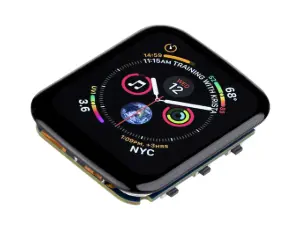

# Waveshare ESP32-C5-Touch-LCD-1.69 Project Examples

[中文](README_ZH.md)

ESP32-C5-Touch-LCD-1.69 is a compact development board built around the ESP32-C5 MCU and equipped with a 1.69-inch touch LCD. It integrates common onboard peripherals such as RGB LED, microphone, speaker, IMU, battery measurement, RTC, and display/touch resources, making it suitable for GUI demos, sensor interaction, audio tests, Wi-Fi applications, and embedded IoT development.

- [Purchase Link](https://www.waveshare.com/shop/ESP32-C5-Touch-LCD-1.69.htm)
- [Documentation](https://docs.waveshare.com/ESP32-C5-Touch-LCD-1.69/)

## 🔧 Setup

You can find detailed hardware resources, development environment setup, and quick-start examples on the ESP32-C5-Touch-LCD-1.69 product wiki page.

This repository provides both Arduino and ESP-IDF examples:

- Arduino examples are located in `example/arduino/examples/`.
- Before using Arduino examples, unzip `example/arduino/ESP32_C5_Touch_LCD_1in69.zip` and place the extracted library into the default Arduino `libraries` directory.
- ESP-IDF examples are located in `example/esp-idf/`.
- The ESP-IDF main entry is `example/esp-idf/main/main.c`. Only one example should be enabled at a time by setting the corresponding macro to `1`.

Available examples include RGB test, microphone and speaker test, IMU test, battery test, RTC test, LVGL demo, Brookesia demo, Wi-Fi connection, and clock display.

## 🛠️ Contributing

We welcome your contributions! You can help in the following ways:

1. Fork this repository.
2. Create a new branch for your feature or bug fix.
3. Commit your changes with a clear and descriptive message.
4. Open a Pull Request for review.

## 🧩 Issues & Support

If you run into any problems:

- First check the issues section.
- Create a new issue and provide detailed information, including symptoms, reproduction steps, hardware environment, and software version.
- Refer to the documentation and example projects for troubleshooting tips.
- Contact the Waveshare team and provide your order number for technical support.

## 📜 License

This repository is licensed under the Apache License. For details, please refer to the [LICENSE](LICENSE) file.

## 🙌 Acknowledgements

- Thanks to Waveshare for providing the ESP32-C5-Touch-LCD-1.69 hardware platform and software support.
- Thanks to Espressif for their continuous support.
- Thanks to all open-source contributors who make these projects possible.

Thank you for using ESP32-C5-Touch-LCD-1.69!
