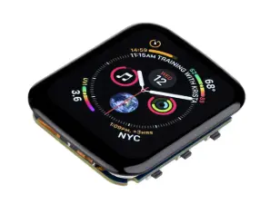

# Waveshare ESP32-C5-Touch-LCD-1.69 工程示例

[English](README.md)

ESP32-C5-Touch-LCD-1.69 是一款小尺寸开发板，主控采用 ESP32-C5 MCU，并板载 1.69 英寸触摸 LCD。板载资源包含 RGB LED、麦克风、扬声器、IMU、电池检测、RTC、显示与触摸等常用外设，可覆盖 GUI 演示、传感器交互、音频测试、Wi-Fi 应用和嵌入式 IoT 开发等场景。

- [购买链接](https://www.waveshare.net/shop/ESP32-C5-Touch-LCD-1.69.htm)
- [产品文档](https://docs.waveshare.net/ESP32-C5-Touch-LCD-1.69/)

## 🔧 Setup

您可以在 ESP32-C5-Touch-LCD-1.69 产品 Wiki 页面中找到详细的硬件资源、开发环境搭建说明和快速上手示例。

本仓库同时提供 Arduino 和 ESP-IDF 示例：

- Arduino 示例位于 `example/arduino/examples/` 目录。
- 使用 Arduino 示例前，请先解压 `example/arduino/ESP32_C5_Touch_LCD_1in69.zip`，并将解压后的库放入 Arduino 默认的 `libraries` 目录。
- ESP-IDF 示例位于 `example/esp-idf/` 目录。
- ESP-IDF 主入口为 `example/esp-idf/main/main.c`。同一时间只应启用一个示例，将对应宏设置为 `1` 即可。

当前示例包含 RGB 测试、麦克风与扬声器测试、IMU 测试、电池测试、RTC 测试、LVGL Demo、Brookesia Demo、Wi-Fi 连接和时钟显示等内容。

## 🛠️ Contributing

我们欢迎您的贡献！您可以通过以下方式提供帮助：

1. Fork 本仓库。
2. 为您的新功能或 Bug 修复创建一个新分支。
3. 提交您的更改并附上清晰、明确的说明。
4. 提交 Pull Request 以供审核。

## 🧩 Issues & Support

如果您遇到任何问题：

- 请先查看 Issues 区域。
- 创建新的 Issue，并提供详细信息，包括问题现象、复现步骤、硬件环境和软件版本等。
- 参考产品文档和示例工程获取故障排查信息。
- 联系微雪团队并提供订单号以获取技术支持。

## 📜 License

本仓库遵循 Apache License 许可。详情请参阅 [LICENSE](LICENSE) 文件。

## 🙌 Acknowledgements

- 感谢微雪电子提供 ESP32-C5-Touch-LCD-1.69 硬件平台和软件支持。
- 感谢乐鑫团队的持续支持。
- 感谢让这些项目成为可能的所有开源贡献者。

感谢您使用 ESP32-C5-Touch-LCD-1.69！
